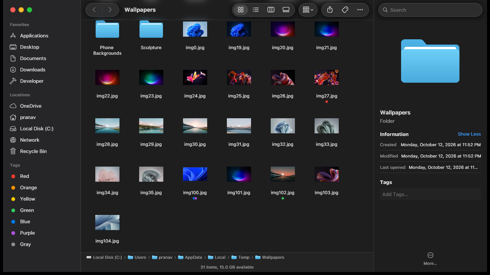

# Finder for Windows

A macOS-style Finder for Windows, built with [GPUI](https://gpui.rs) (Zed's
GPU-accelerated UI framework) on a whole-disk search index that finds files
faster than Everything.



## Features

- **Finder's look**: traffic-light window controls (with Windows Snap Layouts
  on the green one), a translucent sidebar over Windows' Acrylic backdrop, a
  Liquid Glass toolbar and menus that content scrolls beneath (real
  refraction and frost, rendered in a fork of GPUI's DirectX renderer),
  inspector, path and status bars, light and dark mode following Windows.
  With SF Pro installed locally, text uses the font's own macOS tracking.
- **Four views**: list (with folders that expand in place), icons, columns and
  gallery, with real Windows icons and thumbnails.
- **Instant search** across the whole PC as you type, fuzzy and ranked, with
  filters (`ext:pdf`, `kind:dir`, `size:>1gb`, `mtime:<7d`, `in:~/code`) that
  turn into Finder-style chips, scoped to This PC or the current folder.
- **Quick Look** (Space): images, text and code, plus PDFs, video and Office
  documents through Windows' own preview handlers.
- **Color tags**: Finder's seven tags from the toolbar, right-click menu or
  inspector, shown as dots in every view, with a sidebar view of each tag.
- **Toolbar actions**: sort menu, Finder's action menu, and Share through
  Windows' share sheet.
- **File operations**: rename in place, new folder, duplicate, Recycle Bin,
  copy/cut/paste interoperable with Explorer, drag and drop (including from
  Explorer), a right-click menu, and undo (Ctrl+Z), including putting items
  back from the Recycle Bin. Copying and moving go through the Windows shell,
  so its progress window and conflict prompts apply.

## Search engine

`crates/fsearch` is a fork of [fsearch](https://github.com/noahdunnagan/fsearch)
by Noah Dunnagan, ported to Windows: the drives appear under one root, folders
are crawled with `GetFileInformationByHandleEx` (or, when run as administrator,
read straight from the NTFS master file table), and changes are followed with
`ReadDirectoryChangesW`. Its search algorithms (a memory-mapped, folder-grouped
name table with per-letter bitmap prefilters) run unchanged, with AVX2 versions
of its NEON routines.

Measured on a Ryzen 5 7600X over 6.1 million files, top 50 results through
each tool's IPC, median of 20 warm runs:

| Query | fsearch | Everything 1.4 |
|---|---|---|
| `chrome.exe` | 0.27 ms | 62 ms |
| `main.rs` | 0.64 ms | 54 ms |
| `readme` | 1.07 ms | 71 ms |
| no match | 0.13 ms | 55 ms |

`crates/fsearch/examples/vs_everything.rs` reproduces this
(`scripts/bench-vs-everything.ps1`).

## Building

Requires Windows 10 or 11 and Rust 1.85+.

```sh
cargo run -p finder --release
```

The first run indexes the disk (about a minute without admin rights, seconds
with them); the index lives in `%LOCALAPPDATA%\FSearch`.

### Fonts and symbols

Apple's SF Pro font and SF Symbols can't be redistributed, so the app ships
with Inter (if installed) or Segoe UI, and hand-drawn stand-in icons. On a machine with
your own copy of SF Pro (from developer.apple.com/fonts), for local use:

- put the `SF-Pro-Text-*.otf` / `SF-Pro-Display-*.otf` files in
  `%LOCALAPPDATA%\Finder\fonts`, and
- run `crates/finder/assets/extract_symbols.py <font folder> <names.json>` to
  extract the symbols the app uses into `assets/icons/sf/` (git-ignored),
  given an SF Symbols name-to-character map.

## Development

`scripts/dev.sh` rebuilds, relaunches and screenshots the app. For testing
without the keyboard, environment variables set the starting state:
`FINDER_DIR`, `FINDER_VIEW` (`icons`, `columns`, `gallery`), `FINDER_SELECT`,
`FINDER_SEARCH`, `FINDER_APPEARANCE` (`light`, `dark`) and `FINDER_ACTIONS`
(e.g. `finder::NewFolder,wait:500,finder::UndoOp`).

## Credits

- [fsearch](https://github.com/noahdunnagan/fsearch) by Noah Dunnagan (MIT),
  forked in `crates/fsearch`.
- [GPUI](https://github.com/zed-industries/zed) by Zed Industries
  (Apache-2.0); the search field is adapted from its text input example.
- Design after Apple's Finder; not affiliated with Apple.

## License

MIT, see [LICENSE](LICENSE). `crates/fsearch` keeps its own MIT license.
